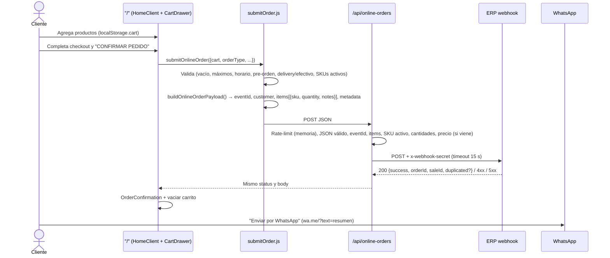

# Arquitectura técnica — Big Jack Menu

**Fecha:** 2026-10-24 · Describe el código **tal como está** en `master`. Para problemas conocidos ver [`AUDIT.md`](./AUDIT.md).

## 1. Stack

| Capa | Tecnología |
| :--- | :--- |
| Framework | Next.js 16 (App Router, Turbopack) |
| UI | React 19.2, Tailwind CSS v4 (`@tailwindcss/postcss`), `lucide-react` |
| Fuentes | `next/font/google`: Poppins (cuerpo), Anton (títulos), Parkinsans |
| Servidor | Route Handler (`/api/online-orders`) + Server Action (`sendComplaint`) |
| Email | Nodemailer (Gmail SMTP) / Formspree opcional |
| Lenguaje | JavaScript (sin TypeScript), alias `@/*` → raíz (`jsconfig.json`) |
| Lint | ESLint 9 + `eslint-config-next/core-web-vitals` |
| Hosting | Vercel (supuesto por URLs `*.vercel.app`) |
| Datos | Sin base de datos. Catálogo estático en `app/data/menuData.js`; estado del usuario en `localStorage`. |

## 2. Mapa del repositorio

```text
app/
├── layout.js                 # Root layout: fuentes, metadata global, JSON-LD (Restaurant + FAQ)
├── page.js                   # "/" — Server Component que compone HomeClient
├── components/SiteHeader.js  # Header compartido (home completo / producto compacto)
├── components/Toast.js       # Avisos info/success/error y confirmación accesible
├── globals.css               # Tailwind + tokens + utilidades de marca + animaciones
├── actions.js                # Server Action: sendComplaint (Libro de Reclamaciones)
├── api/online-orders/route.js# POST proxy al webhook del ERP (validación, rate-limit, timeout)
├── data/menuData.js          # ⭐ Fuente de verdad: restaurantInfo, categories, menuItems (SKUs, precios)
├── lib/
│   ├── cartModel.js          # Ítem de carrito, addItem con topes, migración legacy
│   ├── safeStorage.js        # Lectura/escritura de localStorage con try/catch
│   ├── onlineOrders.js       # Construcción del payload + fetch al proxy
│   └── openHours.js          # Horario en America/Lima: isOpenNow, getNextOpenDate
├── features/home/
│   ├── HomeClient.js         # Isla cliente del home: estado, modales, checkout
│   ├── constants.js          # Límites, categorías, links de apps, URL del sitio
│   ├── cartRules.js          # applyComplementRules (bebidas requieren hamburguesa)
│   ├── hooks/                # useCart, useCheckoutForm, useOpenStatus, useToast
│   ├── context/CartContext.js # CartProvider + useCartDrawer (estado compartido del checkout)
│   ├── seo.js                # Builders de JSON-LD y rangos de precio
│   ├── checkout/submitOrder.js # Validaciones de checkout (cliente) + envío
│   ├── checkout/orderMessages.js # Builders puros: WhatsApp, errores, recordatorios
│   └── components/           # UI del home (CartDrawer, MenuGrid, CategoryCarousel, ProductCard, modales, etc.)
│       └── cart/             # CartItemList, CustomerStep, DeliveryStep, PaymentStep, CartSummary, ItemThumb
├── product/[slug]/
│   ├── page.js               # Detalle de producto (Server Component, SSG)
│   └── ProductAddToCart.js   # Isla cliente: opción, cantidad, reglas de carrito
├── links/page.js             # Linktree (Client)
├── quienes/page.js           # Quiénes somos (Client)
├── libro-de-reclamaciones/page.js # Formulario (Client) → sendComplaint
├── reto-gamer/{page,leaderboard}.js # Juego canvas + récord local
├── robots.js · sitemap.js · manifest.json · icon*/favicon
docs/                          # Esta documentación
public/images/                 # Fotos de producto (.webp), logos, hero
scripts/test-webhook-orders.ps1# Prueba manual del webhook del ERP (⚠️ ver OPS-01)
```

## 3. Rutas

| Ruta | Tipo | Render | Notas |
| :--- | :--- | :--- | :--- |
| `/` | Server Component + `HomeClient` | Estático (○) | Carta, carrito, checkout, modales. |
| `/product/[slug]` | Server + isla cliente | SSG (●) vía `generateStaticParams` | `generateMetadata` por producto. |
| `/links` | Client | Estático | Spinner hasta montar. |
| `/quienes` | Client | Estático | |
| `/libro-de-reclamaciones` | Client | Estático | Usa Server Action. |
| `/reto-gamer` | Client | Estático | Canvas, ~1.670 líneas. |
| `/api/online-orders` | Route Handler | Dinámico (ƒ) | Solo `POST`. |
| `/robots.txt`, `/sitemap.xml`, `/manifest.json` | Metadata routes | Estático | |

## 4. Modelo de datos

### 4.1 Catálogo (`app/data/menuData.js`)

```js
restaurantInfo = {
  name, slogan, ruc,
  hours: { 0..6: { open: "HH:MM", close: "HH:MM" } }, // 0 = domingo; close <= open ⇒ cierra al día siguiente
  logo,
  contact: { whatsapp /* solo dígitos con 51 */, instagram, tiktok, address, googleMapsLink }
}

categories = ["LAS INTOCABLES", "GUARNICIONES", "BEBIDAS"]

menuItems[] = {
  id: number,            // id interno estable (clave del carrito)
  sku: string,           // SKU "por defecto" (= SKU de la primera opción)
  slug: string,          // URL /product/<slug>
  category: string,      // debe existir en `categories`
  name, description,
  image: "/images/*.webp",
  popular: boolean,
  available?: boolean,   // false ⇒ no vendible (oculta del catálogo de SKUs)
  options: [{ id, sku, label, price }] // cada opción tiene SKU propio (lo que se envía al ERP)
}
```

**Invariantes:**
- Cada `option.sku` existe en el ERP y es único. El ERP rechaza SKUs desconocidos.
- `price` es **referencial** en el front: el ERP cobra su `salePrice`.
- Cambiar `id` u `option.id` invalida carritos guardados (se migran por `migrateLegacyCartItems`).

### 4.2 Ítem de carrito (`app/lib/cartModel.js`)

```js
{ id: `${productId}-${optionId}`, productId, category, name,
  optionId, optionLabel, sku, price, image, quantity }
```

`addItem(items, item, quantity, { maxPerItem, maxItems })` devuelve
`{ items, added, reason }` con `reason: "max_per_item" | "max_items" | null`.
Es el único punto que aplica los topes de 10 por producto y 30 por pedido.

### 4.3 Claves de `localStorage`

| Clave | Contenido | Escrita por |
| :--- | :--- | :--- |
| `cart` | Array de ítems de carrito | `useCart`, `ProductAddToCart.js` |
| `bj_checkout` | Nombre, teléfono, dirección, referencia, pago, notas (**PII**) | `useCheckoutForm` (debounce 400 ms) |
| `bj_preorder` | `true` si el carrito es pre-orden | `HomeClient`, `ProductAddToCart.js` |
| `bj_game_data` | Récord del juego + checksum | `reto-gamer/page.js` |
| `bj_local_record_v1` | Mejor partida (nombre, WhatsApp, código) | `reto-gamer/leaderboard.js` |

Las lecturas/escrituras pasan por `lib/safeStorage.js` (try/catch). La sincronización entre `/product/*` y `/` usa el evento `storage` (y un `dispatchEvent(new Event("storage"))` manual en la misma pestaña).

## 5. Flujo de pedido



## 6. API

### `POST /api/online-orders`

**Request** (lo que construye `buildOnlineOrderPayload`):

```json
{
  "eventId": "menu-20261024-ab12cd",
  "orderDate": "2026-10-24T23:15:00.000Z",
  "source": "menu-web",
  "customerName": "Juan Pérez",
  "customerPhone": "+51987654321",
  "customer": { "name": "Juan Pérez", "phone": "+51987654321" },
  "paymentMethod": "yape",
  "notes": "Sin cebolla | Recojo: inmediato (15-20 min)",
  "items": [{ "sku": "PRD-LAB-JFSY", "quantity": 2, "notes": "Clásica (1 carne) - la de siempre" }],
  "metadata": {
    "origin": "menu-web", "channel": "menu-web",
    "orderType": "pickup", "pickupTime": "now", "scheduledTime": null,
    "isPreOrder": false, "locationLink": null, "deliveryAddress": null
  }
}
```

`paymentMethod` ∈ `efectivo | yape | plin | tarjeta` (`cash`/`card` se normalizan).

**Validaciones en el proxy:** JSON válido · `items` no vacío · `eventId` string · cada ítem con `sku` activo y `quantity` entera 1–10 · total ≤ 30 · `price` (si viene) igual al catálogo ±0.01 · máx. 5 pedidos válidos por IP / 15 min.

**Respuestas:**

| Status | Origen | Body |
| :-: | :--- | :--- |
| 200 | ERP | `{ success: true, orderId, saleId, duplicated? }` |
| 400 | Proxy / ERP | `{ success: false, error }` |
| 401 | ERP | Secreto inválido |
| 429 | Proxy | Límite de pedidos |
| 502 | Proxy | Error de red con el ERP |
| 504 | Proxy | Timeout (15 s) |

Contrato del lado ERP: [`webhook-pedidos.md`](./webhook-pedidos.md). Contrato antiguo (deprecado): [`legacy/online-orders-api.md`](./legacy/online-orders-api.md).

### Server Action `sendComplaint(formData)` (`app/actions.js`)

Campos leídos: `name, dni, email, phone, address, type, description, product, amount, request`. Requiere `name`, `email`, `description`. Escapa HTML y envía por Formspree (si `FORMSPREE_URL`) o por Gmail SMTP. Devuelve `{ success, message }`.

## 7. Variables de entorno

| Variable | Requerida | Uso |
| :--- | :-: | :--- |
| `WEBHOOK_ORDERS_URL` | Recomendada | URL completa del webhook. Tiene prioridad. |
| `ERP_BASE_URL` | Si no hay la anterior | Base; se le agrega `/api/webhooks/orders`. Default: `https://bigjack-rp.vercel.app`. |
| `WEBHOOK_MENU_SECRET` | Sí (prod) | Header `x-webhook-secret`. (Alias legacy: `WEBHOOK_SECRET`, `ERP_WEBHOOK_SECRET`.) |
| `GMAIL_USER`, `GMAIL_PASS` | Sí (prod) | SMTP para reclamos (contraseña de aplicación). |
| `RECIPIENT_EMAIL` | Sí (prod) | Destino de reclamos. Default: `bigjackpe@gmail.com`. |
| `FORMSPREE_URL` | No | Canal alternativo de reclamos. |
| `NEXT_PUBLIC_BASE_URL` | Recomendada | URL pública para `metadataBase`, `robots`, `sitemap`. Default: `https://bigjack.vercel.app`. |

Local: copiar `.env.example` a `.env.local`.

## 8. SEO

- `layout.js`: `metadata` global (title template, OG, Twitter, robots) + JSON-LD `Restaurant`/`FastFoodRestaurant` (menú completo con ofertas, horario, geo) y `FAQPage`, generados desde `menuData.js` por `features/home/seo.js`.
- `product/[slug]`: `generateMetadata` por producto.
- `sitemap.js`: páginas estáticas + `/product/<slug>`; `robots.js`: permite todo salvo `/api/`, permite explícitamente bots de IA.

## 9. Build, ejecución y despliegue

```bash
npm install
cp .env.example .env.local   # completar
npm run dev                  # http://localhost:3000
npm run lint
npm run build && npm start
```

Despliegue: Vercel (variables de entorno configuradas en el proyecto). No hay CI ni tests automatizados (OPS-02, QLT-06).

## 10. Decisiones de diseño relevantes

| Decisión | Motivo | Consecuencia |
| :--- | :--- | :--- |
| Catálogo en archivo estático | Simplicidad, SSG, sin DB | Cambiar precios requiere deploy; SKUs deben mantenerse a mano en sync con el ERP. |
| Proxy en vez de llamar al ERP desde el navegador | Ocultar secreto y URL del ERP | El proxy debe ser la barrera de validación (hoy incompleta, SEC-03/05). |
| Precio lo decide el ERP | Evitar manipulación de precios | El total que ve el cliente es referencial. |
| WhatsApp como paso final | Hábito del cliente; coordinar pago/entrega | El pedido queda registrado aunque el cliente no envíe el WhatsApp. |
| Estado en `localStorage` | Sin cuentas de usuario | PII en el dispositivo; sin historial entre dispositivos. |
