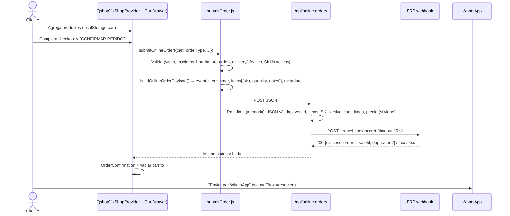

# Arquitectura técnica — Big Jack Menu

**Fecha:** 2026-10-31 · Describe el código **tal como está** en `master`. Para problemas conocidos ver [`AUDIT.md`](./AUDIT.md).

## 1. Stack

| Capa | Tecnología |
| :--- | :--- |
| Framework | Next.js 16 (App Router, Turbopack) |
| UI | React 19.2, Tailwind CSS v4 (`@tailwindcss/postcss`), `lucide-react` |
| Fuentes | `next/font/google`: Poppins (cuerpo), Anton (títulos) |
| Servidor | Route Handler (`/api/online-orders`) + Server Action (`sendComplaint`) |
| Email | Nodemailer (Gmail SMTP) / Formspree opcional |
| Lenguaje | JavaScript (sin TypeScript), alias `@/*` → raíz (`jsconfig.json`) |
| Lint | ESLint 9 + `eslint-config-next/core-web-vitals` |
| Hosting | Vercel (supuesto por URLs `*.vercel.app`) |
| Datos | Sin base de datos. Catálogo estático en `app/data/menuData.js`; estado del usuario en `localStorage`. |

## 2. Mapa del repositorio

```text
app/
├── layout.js                    # Root: fuentes, viewport, metadata global, JSON-LD Restaurant + WebSite
├── (shop)/                      # Grupo con header, carrito y footer compartidos (el carrito persiste al navegar)
│   ├── layout.js                # ShopProvider + SiteHeader + ClosedBanner + SiteFooter + ShopOverlays
│   ├── page.js                  # "/" (Server): Hero en scroll, carta, ubicación, FAQ + JSON-LD FAQPage
│   ├── product/[slug]/          # Ficha (Server, SSG) + ProductAddToCart (isla cliente) + JSON-LD Product
│   ├── quienes/page.js          # Server Component
│   └── libro-de-reclamaciones/  # page.js (Server, metadata) + ComplaintForm.js (cliente) → sendComplaint
├── components/                  # UI compartida: SiteHeader, SiteFooter, Dialog, Toast, JsonLd, icons/BrandIcons
├── data/menuData.js             # ⭐ Fuente única: restaurantInfo (horario, dirección, contacto, apps), categoryInfo, menuItems
├── lib/                         # Dominio puro con tests
│   ├── site.js                  # SITE_URL, absoluteUrl, whatsappUrl, formatPhone, formatAddress, instagramUrl
│   ├── schedule.js              # formatTime, groupSchedule, formatScheduleSummary, formatPrepTime
│   ├── format.js                # formatPrice, getPriceRange, getMenuPriceRange
│   ├── openHours.js             # isOpenNow, getNextOpenDate, getOpenStatusLabel (hora de Lima)
│   ├── llms.js                  # Contenido de /llms.txt generado desde los datos
│   ├── cartModel.js · onlineOrders.js · safeStorage.js
├── features/shop/
│   ├── constants.js             # Reglas: categorías, máximos, métodos de pago, upsell
│   ├── cartRules.js             # Bebidas solo con hamburguesa
│   ├── seo.js                   # JSON-LD (Restaurant, Product, Breadcrumb, FAQPage) y FAQ visible
│   ├── checkout/                # submitOrder (validaciones) y orderMessages (WhatsApp, errores)
│   ├── context/ShopContext.js   # ShopProvider + useShop: compone los hooks
│   ├── hooks/                   # useCart, useCartActions, useCheckoutForm, useOrderSubmit, useUpsell,
│   │                            # useGeolocation, useOpenStatus, useToast, useNotice, useScrollSpy, useScrollProgress
│   └── components/
│       ├── hero/                # HeroSection (Server) + ScrollHero (animación por scroll)
│       ├── menu/                # MenuSection, CategoryNav (scroll-spy), FeatureItem, CompactItem
│       ├── cart/                # Pasos del checkout con <label>: Customer, Delivery, Payment, Summary, ItemList
│       ├── overlays/            # ShopOverlays (dynamic import), ProductSheet, UpsellSheet, OrderConfirmation
│       └── …                    # CartDrawer, FloatingCartBar, ClosedBanner, LocationSection, FaqSection…
├── links/                       # Link-in-bio (Server) + OpenStatusBadge (isla)
├── reto-gamer/                  # Juego canvas (pendiente D7) + layout.js con metadata
├── actions.js                   # Server Action: sendComplaint
├── api/online-orders/route.js   # Proxy al webhook del ERP
├── robots.js · sitemap.js · manifest.js · llms.txt/route.js · not-found.js
public/images/                   # Fotos .webp, burger-hero.webp, og-bigjack.jpg, logos
scripts/                         # generate-og.js, test-webhook-orders.ps1 (⚠️ OPS-01)
```

## 3. Rutas

| Ruta | Render | Notas |
| :--- | :--- | :--- |
| `/` | Estático (○) | Server Component con islas: hero en scroll, carta, ubicación y FAQ. |
| `/product/[slug]` | SSG (●) | Mismo carrito y drawer que la carta (layout compartido). |
| `/quienes` | Estático | Server Component. |
| `/libro-de-reclamaciones` | Estático | Página server con metadata + formulario cliente. |
| `/links` | Estático | Server + isla de estado abierto/cerrado. Sin spinner. |
| `/reto-gamer` | Estático | Client (canvas). |
| `/api/online-orders` | Dinámico (ƒ) | Solo `POST`. |
| `/robots.txt`, `/sitemap.xml`, `/manifest.webmanifest`, `/llms.txt` | Estático | Generados desde `menuData.js`. |

## 4. Modelo de datos

### 4.1 Catálogo (`app/data/menuData.js`)

```js
restaurantInfo = {
  name, slogan, ruc,
  hours: { 0..6: { open: "HH:MM", close: "HH:MM" } }, // 0 = domingo; close <= open ⇒ cierra al día siguiente
  logo,
  contact: { whatsapp /* solo dígitos con 51 */, instagram, tiktok, address, googleMapsLink }
}

categories = ["LAS INTOCABLES", "GUARNICIONES", "BEBIDAS"]

menuItems[] = {
  id: number,            // id interno estable (clave del carrito)
  sku: string,           // SKU "por defecto" (= SKU de la primera opción)
  slug: string,          // URL /product/<slug>
  category: string,      // debe existir en `categories`
  name, description,
  image: "/images/*.webp",
  popular: boolean,
  available?: boolean,   // false ⇒ no vendible (oculta del catálogo de SKUs)
  options: [{ id, sku, label, price }] // cada opción tiene SKU propio (lo que se envía al ERP)
}
```

**Invariantes:**
- Cada `option.sku` existe en el ERP y es único. El ERP rechaza SKUs desconocidos.
- `price` es **referencial** en el front: el ERP cobra su `salePrice`.
- Cambiar `id` u `option.id` invalida carritos guardados (se migran por `migrateLegacyCartItems`).

### 4.2 Ítem de carrito (`app/lib/cartModel.js`)

```js
{ id: `${productId}-${optionId}`, productId, category, name,
  optionId, optionLabel, sku, price, image, quantity }
```

`addItem(items, item, quantity, { maxPerItem, maxItems })` devuelve
`{ items, added, reason }` con `reason: "max_per_item" | "max_items" | null`.
Es el único punto que aplica los topes de 10 por producto y 30 por pedido.

### 4.3 Claves de `localStorage`

| Clave | Contenido | Escrita por |
| :--- | :--- | :--- |
| `cart` | Array de ítems de carrito | `useCart` |
| `bj_checkout` | Nombre, teléfono, dirección, referencia, pago, notas (**PII**) | `useCheckoutForm` (debounce 400 ms) |
| `bj_game_data` | Récord del juego + checksum | `reto-gamer/page.js` |
| `bj_local_record_v1` | Mejor partida (nombre, WhatsApp, código) | `reto-gamer/leaderboard.js` |

Las lecturas/escrituras pasan por `lib/safeStorage.js` (try/catch). La carta y la ficha de producto comparten el mismo `ShopProvider` (layout de `(shop)`), así que no hace falta sincronizar entre páginas; el evento `storage` solo sincroniza pestañas. La pre-orden ya no se guarda: es pre-orden todo pedido confirmado fuera de horario (y solo admite recojo).

## 5. Flujo de pedido



## 6. API

### `POST /api/online-orders`

**Request** (lo que construye `buildOnlineOrderPayload`):

```json
{
  "eventId": "menu-20261024-ab12cd",
  "orderDate": "2026-10-24T23:15:00.000Z",
  "source": "menu-web",
  "customerName": "Juan Pérez",
  "customerPhone": "+51987654321",
  "customer": { "name": "Juan Pérez", "phone": "+51987654321" },
  "paymentMethod": "yape",
  "notes": "Sin cebolla | Recojo: inmediato (15-20 min)",
  "items": [{ "sku": "PRD-LAB-JFSY", "quantity": 2, "notes": "Clásica (1 carne) - la de siempre" }],
  "metadata": {
    "origin": "menu-web", "channel": "menu-web",
    "orderType": "pickup", "pickupTime": "now", "scheduledTime": null,
    "isPreOrder": false, "locationLink": null, "deliveryAddress": null
  }
}
```

`paymentMethod` ∈ `efectivo | yape | plin | tarjeta` (`cash`/`card` se normalizan).

**Validaciones en el proxy:** JSON válido · `items` no vacío · `eventId` string · cada ítem con `sku` activo y `quantity` entera 1–10 · total ≤ 30 · `price` (si viene) igual al catálogo ±0.01 · máx. 5 pedidos válidos por IP / 15 min.

**Respuestas:**

| Status | Origen | Body |
| :-: | :--- | :--- |
| 200 | ERP | `{ success: true, orderId, saleId, duplicated? }` |
| 400 | Proxy / ERP | `{ success: false, error }` |
| 401 | ERP | Secreto inválido |
| 429 | Proxy | Límite de pedidos |
| 502 | Proxy | Error de red con el ERP |
| 504 | Proxy | Timeout (15 s) |

Contrato del lado ERP: [`webhook-pedidos.md`](./webhook-pedidos.md). Contrato antiguo (deprecado): [`legacy/online-orders-api.md`](./legacy/online-orders-api.md).

### Server Action `sendComplaint(formData)` (`app/actions.js`)

Campos leídos: `name, dni, email, phone, address, type, description, product, amount, request`. Requiere `name`, `email`, `description`. Escapa HTML y envía por Formspree (si `FORMSPREE_URL`) o por Gmail SMTP. Devuelve `{ success, message }`.

## 7. Variables de entorno

| Variable | Requerida | Uso |
| :--- | :-: | :--- |
| `WEBHOOK_ORDERS_URL` | Recomendada | URL completa del webhook. Tiene prioridad. |
| `ERP_BASE_URL` | Si no hay la anterior | Base; se le agrega `/api/webhooks/orders`. Default: `https://bigjack-rp.vercel.app`. |
| `WEBHOOK_MENU_SECRET` | Sí (prod) | Header `x-webhook-secret`. (Alias legacy: `WEBHOOK_SECRET`, `ERP_WEBHOOK_SECRET`.) |
| `GMAIL_USER`, `GMAIL_PASS` | Sí (prod) | SMTP para reclamos (contraseña de aplicación). |
| `RECIPIENT_EMAIL` | Sí (prod) | Destino de reclamos. Default: `bigjackpe@gmail.com`. |
| `FORMSPREE_URL` | No | Canal alternativo de reclamos. |
| `NEXT_PUBLIC_BASE_URL` | Recomendada | URL pública para `metadataBase`, canonicals, JSON-LD, `robots`, `sitemap`, `llms.txt`. Default: `https://bigjack.vercel.app` (`lib/site.js`). |
| `GOOGLE_SITE_VERIFICATION` | No | Código de Search Console; si no existe no se publica la meta (SEO-03). |

Local: copiar `.env.example` a `.env.local`.

## 8. SEO e IA

- `layout.js`: metadata global (title template, OG con `og-bigjack.jpg`, Twitter, robots, `viewport`/`themeColor`) y JSON-LD `@graph` con `WebSite` + `Restaurant` (dirección de `restaurantInfo.address`, horario, menú con URL e imagen absoluta de cada plato).
- Cada página define `alternates.canonical` y su propio `title`/`description`.
- `/` publica `FAQPage` con las mismas preguntas que muestra (`getFaqItems`).
- `/product/[slug]`: `Product` (AggregateOffer) + `BreadcrumbList`.
- `sitemap.js` con imágenes; `robots.js` permite buscadores y asistentes de IA (GPTBot, OAI-SearchBot, ClaudeBot, PerplexityBot, Google-Extended…) salvo `/api/`.
- `/llms.txt`: resumen en Markdown (datos del local, carta con precios, cómo pedir, FAQ) generado desde `menuData.js`.

## 9. Build, ejecución y despliegue

```bash
npm install
cp .env.example .env.local   # completar
npm run dev                  # http://localhost:3000
npm run lint
npm run build && npm start
```

Despliegue: Vercel (variables de entorno configuradas en el proyecto). CI en `.github/workflows/ci.yml` (lint, test, build, audit).

## 10. Decisiones de diseño relevantes

| Decisión | Motivo | Consecuencia |
| :--- | :--- | :--- |
| Catálogo en archivo estático | Simplicidad, SSG, sin DB | Cambiar precios requiere deploy; SKUs deben mantenerse a mano en sync con el ERP. |
| Proxy en vez de llamar al ERP desde el navegador | Ocultar secreto y URL del ERP | El proxy debe ser la barrera de validación (hoy incompleta, SEC-03/05). |
| Precio lo decide el ERP | Evitar manipulación de precios | El total que ve el cliente es referencial. |
| WhatsApp como paso final | Hábito del cliente; coordinar pago/entrega | El pedido queda registrado aunque el cliente no envíe el WhatsApp. |
| Estado en `localStorage` | Sin cuentas de usuario | PII en el dispositivo; sin historial entre dispositivos. |
| Layout `(shop)` con `ShopProvider` | Un solo carrito para carta, ficha y páginas informativas | El estado vive en el cliente; las secciones estáticas siguen siendo Server Components (`children`). |
| Diálogos con `next/dynamic` | El JS del drawer y las hojas se descarga al abrirlos | Primer clic en "Ver pedido" carga un chunk pequeño. |
| Hero animado con una variable CSS (`--p`) | Sin librerías de animación ni renders por frame | `prefers-reduced-motion` muestra la versión estática. |
