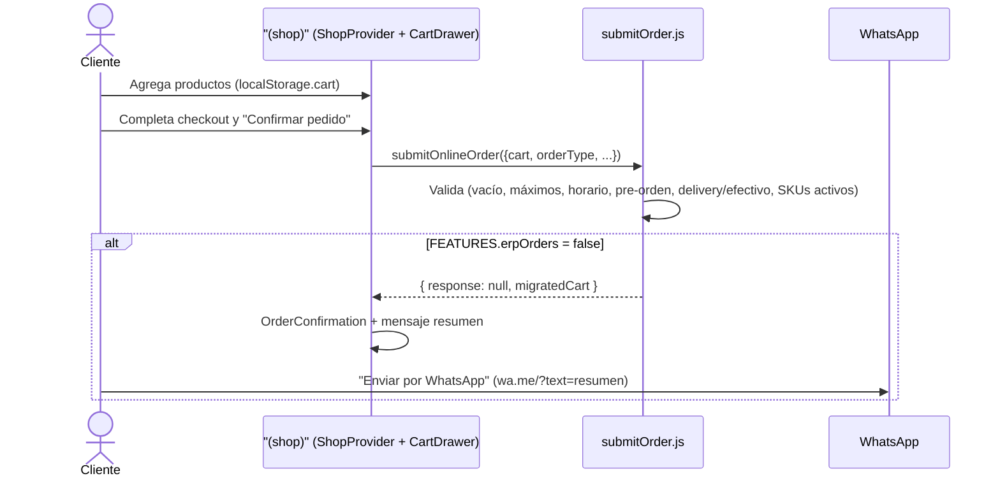
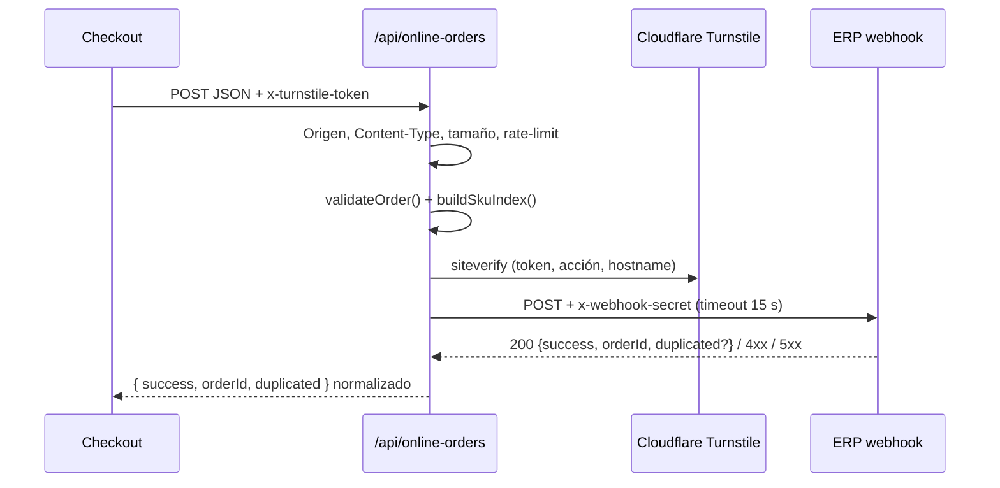

# Arquitectura técnica — Big Jack Menu

**Fecha:** 2026-11-02 · Describe el código **tal como está** en `master`. Los problemas conocidos y su estado están en [`AUDIT.md`](./AUDIT.md).

## 1. Stack

| Capa | Tecnología |
| :--- | :--- |
| Framework | Next.js 16.4 (App Router, Turbopack) |
| UI | React 19.3, Tailwind CSS v4 (`@tailwindcss/postcss`), `lucide-react` |
| Fuentes | `next/font/google`: Poppins (cuerpo), Anton (títulos) |
| Servidor | Route Handler (`/api/online-orders`) + Server Action (`sendComplaint`) |
| Email | Nodemailer (Gmail SMTP) / Formspree opcional |
| Anti-bots | Cloudflare Turnstile |
| Analítica | Google Analytics 4 + Google Tag Manager (`@next/third-parties`) |
| Lenguaje | JavaScript (sin TypeScript), alias `@/*` → raíz (`jsconfig.json`) |
| Lint | ESLint 9 + `eslint-config-next/core-web-vitals` + `max-lines` |
| Tests | Vitest 5 (94 tests) |
| Hosting | Vercel |
| Datos | Sin base de datos. Catálogo estático en `app/data/menuData.js`; estado del usuario en `localStorage`. |

### Flags de funcionalidad (`app/lib/site.js`)

| Flag | Valor actual | Efecto |
| :--- | :-: | :--- |
| `FEATURES.erpOrders` | `false` | El checkout valida y arma el pedido, pero **no** llama al ERP: la confirmación se envía por WhatsApp. El proxy y Turnstile quedan intactos. |
| `FEATURES.complaintsBook` | `false` | `/libro-de-reclamaciones` muestra un aviso con WhatsApp, no indexa y sale del footer, `/links`, sitemap y `llms.txt`. Reactivación prevista: enero 2027. |

## 2. Mapa del repositorio

```text
app/
├── layout.js                    # Root: fuentes, viewport, metadata global, JSON-LD Restaurant + WebSite, GA/GTM
├── (shop)/                      # Grupo con header, carrito y footer compartidos
│   ├── layout.js                # ShopProvider + SiteHeader + ClosedBanner + SiteFooter + ShopOverlays
│   ├── page.js                  # "/" (Server): hero en scroll, carta, ubicación y FAQ
│   ├── product/[slug]/          # Ficha (Server, SSG) + ProductAddToCart (isla cliente)
│   ├── quienes/page.js          # Server Component
│   ├── privacidad/page.js       # Política de privacidad (Ley N.° 29733)
│   └── libro-de-reclamaciones/  # page.js (Server) + ComplaintForm.js (cliente) → sendComplaint
├── components/                  # SiteHeader, SiteFooter, Dialog, Toast, JsonLd, icons/BrandIcons
├── data/menuData.js             # ⭐ Fuente única: restaurantInfo, categoryInfo, menuItems, legacySlugs
├── lib/                         # Dominio puro con tests
│   ├── site.js                  # SITE_URL, FEATURES, URLs de WhatsApp/Instagram, dirección, features
│   ├── schedule.js              # formatTime, groupSchedule, formatScheduleSummary, formatPrepTime
│   ├── format.js                # formatPrice, getPriceRange, getMenuPriceRange
│   ├── openHours.js             # isOpenNow, getNextOpenDate (hora de Lima)
│   ├── orderRules.js            # Validación y reconstrucción del pedido en servidor
│   ├── catalog.js               # Índice de SKUs activos
│   ├── cartModel.js             # Ítems de carrito, topes, migración y reglas
│   ├── onlineOrders.js          # Payload del webhook, eventId y cliente HTTP
│   ├── analytics.js             # Eventos GA4
│   ├── turnstile.js / turnstileClient.js / turnstileConfig.js
│   ├── safeStorage.js           # Acceso protegido a localStorage
│   └── llms.js                  # Contenido de /llms.txt generado desde los datos
├── features/shop/
│   ├── constants.js             # Categorías, máximos, métodos de pago, upsell
│   ├── cartRules.js             # Bebidas solo con hamburguesa
│   ├── seo.js                   # JSON-LD (Restaurant, Product, Breadcrumb, FAQPage) y FAQ visible
│   ├── checkout/                # submitOrder (validaciones) y orderMessages (WhatsApp, errores)
│   ├── context/ShopContext.js   # ShopProvider + useShop
│   ├── hooks/                   # useCart, useCartActions, useCheckoutForm, useOrderSubmit, useUpsell,
│   │                            # useGeolocation, useOpenStatus, useToast, useNotice, useScrollSpy…
│   └── components/
│       ├── hero/                # HeroSection (Server) + ScrollHero
│       ├── menu/                # MenuSection, CategoryNav, FeatureItem, CompactItem
│       ├── cart/                # Pasos del checkout, resumen, campos y Turnstile
│       └── overlays/            # ShopOverlays, ProductSheet, UpsellSheet, OrderConfirmation
├── links/                       # Link-in-bio (Server) + OpenStatusBadge (isla)
├── reto-gamer/                  # "Arma tu burger": page (Server) + BurgerGame + game/engine.js (puro, con tests)
├── actions.js                   # Server Action: sendComplaint
├── api/online-orders/route.js   # Proxy al webhook del ERP
├── robots.js · sitemap.js · manifest.js · llms.txt/route.js · not-found.js · error.js · global-error.js
public/
├── images/                      # Fotos .webp, burger-hero.webp, og-bigjack.jpg, og/<slug>.jpg, brands/
├── brand/                       # Logos SVG (horizontal, apilado, sello, monograma)
└── web-app-manifest-192x192.png · web-app-manifest-512x512.png
scripts/
├── brand/                       # Kit de marca: npm run brand
├── generate-og.js               # OG general: npm run og
├── generate-product-og.mjs      # OG por producto: npm run og
└── test-webhook-orders.ps1      # ⚠️ Solo contra staging/local (ver OPS-01)
```

## 3. Rutas

| Ruta | Render | Notas |
| :--- | :--- | :--- |
| `/` | Estático (○) | Server Component con islas: hero en scroll, carta, ubicación y FAQ. |
| `/product/[slug]` | SSG (●) | Mismo carrito y drawer que la carta (layout compartido). |
| `/quienes` | Estático | Server Component con metadata propia. |
| `/privacidad` | Estático | Política de privacidad conforme a la Ley N.° 29733. |
| `/libro-de-reclamaciones` | Estático | Página server + formulario cliente. **Desactivado** (`FEATURES.complaintsBook`): muestra un aviso y no indexa. |
| `/links` | Estático | Server + isla de estado abierto/cerrado. Sin spinner. |
| `/reto-gamer` | Estático | "Arma tu burger": juego de apilar para la espera; récord en `localStorage`. |
| `/api/online-orders` | Dinámico (ƒ) | Solo `POST`. |
| `/robots.txt`, `/sitemap.xml`, `/manifest.webmanifest`, `/llms.txt` | Estático | Generados desde `menuData.js`. |

Redirecciones 308 de slugs antiguos en `next.config.mjs` (`legacySlugs`).

## 4. Modelo de datos

### 4.1 Catálogo (`app/data/menuData.js`)

```js
restaurantInfo = {
  name, legalName, ruc, slogan, description,
  hours: { 0..6: { open: "HH:MM", close: "HH:MM" } }, // 0 = domingo; close <= open ⇒ cierra al día siguiente
  prepTimeMinutes: { min, max },
  logo,
  address: { street, area, locality, region, postalCode, country },
  contact: { whatsapp /* solo dígitos con 51 */, instagram, tiktok, googleMapsLink, googleReviewLink },
  deliveryApps: { rappi }
}

categoryInfo = { "LAS INTOCABLES": {...}, "BEBIDAS": {...} }
categories = ["LAS INTOCABLES", "BEBIDAS"]

menuItems[] = {
  id: number,            // id interno estable (clave del carrito)
  sku: string,           // SKU "por defecto" (= SKU de la primera opción)
  slug: string,          // URL /product/<slug>
  category: string,      // debe existir en `categories`
  name, description,
  image: "/images/*.webp",
  popular: boolean,
  available?: boolean,   // false ⇒ no vendible (no aparece en catálogo de SKUs)
  options: [{ id, sku, label, price }] // cada opción tiene SKU propio (lo que se envía al ERP)
}
```

**Estado actual de la carta:**
- **Hamburguesas:** Clásica, con Tocino, Royal y a lo Pobre, en versión Simple (1 carne) o Doble (2 carnes) según el producto. **Todas incluyen papas fritas.**
- **Bebidas:** Inca Kola, Coca-Cola y Agua Cielo.
- **Papas Fritas** sigue en los datos con `available: false` porque ya vienen incluidas; su slug redirige a la carta.
- La constante `SIDES_CATEGORY = "GUARNICIONES"` se conserva por compatibilidad del modelo, pero hoy no hay una categoría visible de acompañamientos.

**Invariantes:**
- Cada `option.sku` existe en el ERP y es único. El ERP rechaza SKUs desconocidos.
- `price` es **referencial** en el front: en modo ERP el precio final lo calcula el ERP.
- Cambiar `id` u `option.id` invalida carritos guardados (se migran con `migrateLegacyCartItems`).

### 4.2 Ítem de carrito (`app/lib/cartModel.js`)

```js
{ id: `${productId}-${optionId}`, productId, category, name,
  optionId, optionLabel, sku, price, image, quantity }
```

`addItem(items, item, quantity, { maxPerItem, maxItems })` devuelve
`{ items, added, reason }` con `reason: "max_per_item" | "max_items" | null`.
Es el único punto que aplica los topes de 10 por producto y 30 por pedido.

### 4.3 Claves de `localStorage`

| Clave | Contenido | Escrita por |
| :--- | :--- | :--- |
| `cart` | Array de ítems de carrito | `useCart` |
| `bj_checkout` | Nombre, teléfono, dirección, referencia, pago, notas (**PII**) | `useCheckoutForm` (debounce 400 ms) |
| `bj_burger_stats` | Récord, partidas y últimos 5 puntajes del juego (sin datos personales) | `reto-gamer/BurgerGame.js` |

Las lecturas/escrituras pasan por `lib/safeStorage.js` (try/catch). La carta y la ficha de producto comparten el mismo `ShopProvider` (layout de `(shop)`), así que no hace falta sincronizar entre páginas; el evento `storage` solo sincroniza pestañas. La pre-orden no se guarda: es pre-orden todo pedido confirmado fuera de horario (y solo admite recojo).

## 5. Flujo de pedido

### 5.1 Modo actual (WhatsApp)



El pedido **no** se registra en el ERP mientras `FEATURES.erpOrders` sea `false`. La confirmación muestra el resumen y el total referencial; el pago y la entrega se coordinan por WhatsApp.

### 5.2 Modo ERP (`FEATURES.erpOrders = true`)



## 6. API

### `POST /api/online-orders`

**Request** (lo que construye `buildOnlineOrderPayload`):

```json
{
  "eventId": "menu-20261102-ab12cd",
  "orderDate": "2026-11-02T23:15:00.000Z",
  "source": "menu-web",
  "customerName": "Juan Pérez",
  "customerPhone": "+51987654321",
  "customer": { "name": "Juan Pérez", "phone": "+51987654321" },
  "paymentMethod": "yape",
  "notes": "Sin cebolla | Recojo: inmediato (15-20 min)",
  "items": [{ "sku": "PRD-LAB-JFSY", "quantity": 2, "notes": "Simple (1 carne)" }],
  "metadata": {
    "origin": "menu-web", "channel": "menu-web",
    "orderType": "pickup", "pickupTime": "now", "scheduledTime": null,
    "isPreOrder": false, "locationLink": null, "deliveryAddress": null
  }
}
```

`paymentMethod` ∈ `efectivo | yape | plin | tarjeta` (`cash`/`card` se normalizan).

**Seguridad y validaciones en el servidor** (`route.js` + `lib/orderRules.js` + `lib/catalog.js`):

- Solo mismo origen (`Origin` = host; `Sec-Fetch-Site` ≠ `cross-site`) → si no, `403`. `Content-Type: application/json` → si no, `415`. Cuerpo ≤ 16 KB → si no, `413`.
- Máx. 5 pedidos válidos por IP cada 15 min y uno cada 20 s (en memoria, por instancia; ver SEC-04). Si el ERP falla, el intento no cuenta.
- **Cloudflare Turnstile:** el navegador envía el token en la cabecera `x-turnstile-token` (el cuerpo no cambia). El servidor lo valida con `siteverify` (éxito, acción `checkout`, dominio) **antes** de llamar al ERP; sin token o inválido → `403`. Si Cloudflare no responde, se rechaza. Widget invisible (`appearance: interaction-only`) en el paso de entrega y pago (`lib/turnstileClient.js`, `cart/TurnstileWidget.js`); servidor en `lib/turnstile.js`.
- `eventId` con formato válido · ítems con `sku` vendible, `quantity` entera 1–10, total ≤ 30, `price` (si viene) igual al catálogo · bebidas solo con hamburguesa · `orderType` `pickup`/`delivery` · método de pago válido y sin efectivo en delivery · delivery con dirección o ubicación · **horario calculado en el servidor**: cerrado ⇒ solo recojo y `isPreOrder: true`.
- El pedido que va al ERP se **reconstruye con lista blanca** (misma forma que la de arriba): se descartan campos desconocidos, se recortan textos, se quitan caracteres de control, `orderDate` lo pone el servidor y `locationLink` solo se acepta si es un link de Google Maps con coordenadas.

**Respuestas:**

| Status | Origen | Body |
| :-: | :--- | :--- |
| 200 | Proxy | `{ success: true, orderId, duplicated }` (respuesta normalizada; la del ERP no se reenvía) |
| 400 | Proxy | `{ success: false, error }` (regla de negocio o formato) |
| 403 / 413 / 415 | Proxy | Origen no permitido o Turnstile inválido / cuerpo muy grande / no es JSON |
| 422 | Proxy | El ERP rechazó el pedido (detalle solo en el log del servidor) |
| 429 | Proxy | Límite de pedidos |
| 502 | Proxy | Error del ERP o de red |
| 504 | Proxy | Timeout (15 s) |

Contrato del lado ERP: [`webhook-pedidos.md`](./webhook-pedidos.md). Contrato antiguo (deprecado): [`legacy/online-orders-api.md`](./legacy/online-orders-api.md).

### Server Action `sendComplaint(formData)` (`app/actions.js`)

Campos leídos: `name, dni, email, phone, address, type, description, product, amount, request`. Requiere `name`, `email`, `description`. Escapa HTML y envía por Formspree (si `FORMSPREE_URL`) o por Gmail SMTP. Devuelve `{ success, message }`. **Hoy rechaza reclamos** mientras `FEATURES.complaintsBook` sea `false`.

## 7. Variables de entorno

| Variable | Requerida | Uso |
| :--- | :-: | :--- |
| `WEBHOOK_ORDERS_URL` | Recomendada | URL completa del webhook. Tiene prioridad. |
| `ERP_BASE_URL` | Si no hay la anterior | Base; se le agrega `/api/webhooks/orders`. Default: `https://bigjack-rp.vercel.app`. |
| `WEBHOOK_MENU_SECRET` | Sí (prod) | Header `x-webhook-secret`. (Alias legacy: `WEBHOOK_SECRET`, `ERP_WEBHOOK_SECRET`.) |
| `GMAIL_USER`, `GMAIL_PASS` | Sí (prod) | SMTP para reclamos (contraseña de aplicación). |
| `RECIPIENT_EMAIL` | Sí (prod) | Destino de reclamos. Default: `bigjackpe@gmail.com`. |
| `FORMSPREE_URL` | No | Canal alternativo de reclamos. |
| `NEXT_PUBLIC_BASE_URL` | Recomendada | URL pública para `metadataBase`, canonicals, JSON-LD, `robots`, `sitemap`, `llms.txt`. Default: `https://bigjack.vercel.app` (`lib/site.js`). |
| `GOOGLE_SITE_VERIFICATION` | No | Sobrescribe el código de Search Console. |
| `NEXT_PUBLIC_GTM_ID` | No | Contenedor de Google Tag Manager (`GTM-…`). Vacío = no se carga GTM. |
| `NEXT_PUBLIC_GA_ID` | No | ID de medición de GA4 (`G-…`). Si no se define, se usa `G-YQP6YH6PR4` (`lib/site.js`). |
| `NEXT_PUBLIC_TURNSTILE_SITE_KEY` | Sí (prod) | Clave pública del widget de Cloudflare Turnstile. |
| `TURNSTILE_SECRET_KEY` | Sí (prod) | Clave secreta de Turnstile (solo servidor, solo en Vercel). Sin ella en producción el chequeo anti-bots queda **apagado** (se avisa en el log). En desarrollo se usan las claves de prueba de Cloudflare. |

Local: copiar `.env.example` a `.env.local`.

## 8. SEO e IA

- `layout.js`: metadata global (title template, OG con `og-bigjack.jpg`, Twitter, robots, `viewport`/`themeColor`) y JSON-LD `@graph` con `WebSite` + `Restaurant` (dirección de `restaurantInfo.address`, horario, menú con URL e imagen absoluta de cada plato).
- Cada página define `alternates.canonical` y su propio `title`/`description`.
- `/` publica `FAQPage` con las mismas preguntas que muestra (`getFaqItems`).
- `/product/[slug]`: `Product` (AggregateOffer) + `BreadcrumbList`.
- `sitemap.js` con imágenes; `robots.js` permite buscadores y asistentes de IA (GPTBot, OAI-SearchBot, ClaudeBot, PerplexityBot, Google-Extended…) salvo `/api/`.
- Search Console verificado con `<meta name="google-site-verification">` (`lib/site.js`).
- Google Analytics 4 con `@next/third-parties` (se carga después de la hidratación). Eventos en `lib/analytics.js`: `view_item`, `add_to_cart`, `remove_from_cart`, `view_cart`, `begin_checkout`, `purchase`, `whatsapp_order_sent`, `game_start`, `post_score`. Los clics salientes (WhatsApp, apps) los mide la medición mejorada de GA4.
- `/llms.txt`: resumen en Markdown (datos del local, carta con precios, cómo pedir, FAQ) generado desde `menuData.js`.

## 9. Build, tests y despliegue

```bash
npm install
cp .env.example .env.local   # completar lo necesario
npm run dev                  # http://localhost:3000
npm run lint                 # 0 errores / 0 warnings
npm test                     # 94 tests
npm run build                # prebuild ejecuta npm run og
npm start
```

Despliegue: Vercel (variables de entorno configuradas en el proyecto). CI en `.github/workflows/ci.yml` (lint, test, build, audit).

## 10. Decisiones de diseño relevantes

| Decisión | Motivo | Consecuencia |
| :--- | :--- | :--- |
| Catálogo en archivo estático | Simplicidad, SSG, sin DB | Cambiar precios requiere deploy; SKUs deben mantenerse a mano en sync con el ERP. |
| WhatsApp como paso final (hoy único) | Hábito del cliente; coordinar pago/entrega sin comisiones | No hay registro automático en el ERP hasta reactivar `erpOrders`. |
| Proxy en vez de llamar al ERP desde el navegador | Ocultar secreto y URL del ERP | El proxy es la barrera de validación y anti-abuso. |
| Precio lo decide el ERP | Evitar manipulación de precios | El total que ve el cliente es referencial. |
| Estado en `localStorage` | Sin cuentas de usuario | PII en el dispositivo; sin historial entre dispositivos. |
| Layout `(shop)` con `ShopProvider` | Un solo carrito para carta, ficha y páginas informativas | El estado vive en el cliente; las secciones estáticas siguen siendo Server Components (`children`). |
| Diálogos con `next/dynamic` | El JS del drawer y las hojas se descarga al abrirlos | Primer clic en "Ver pedido" carga un chunk pequeño. |
| Hero animado con una variable CSS (`--p`) | Sin librerías de animación ni renders por frame | `prefers-reduced-motion` muestra la versión estática. |
| Flags en `lib/site.js` | Apagar/reactivar funciones sin borrar código | ERP y Libro de Reclamaciones se activan con un booleano y un deploy. |
